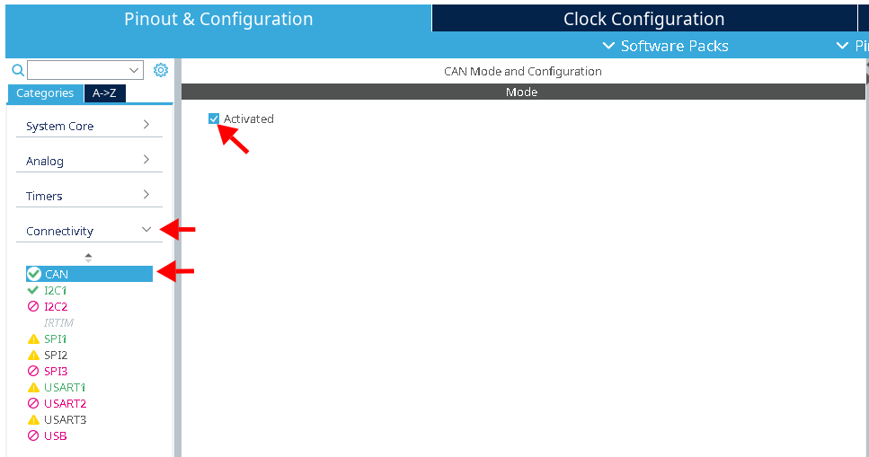
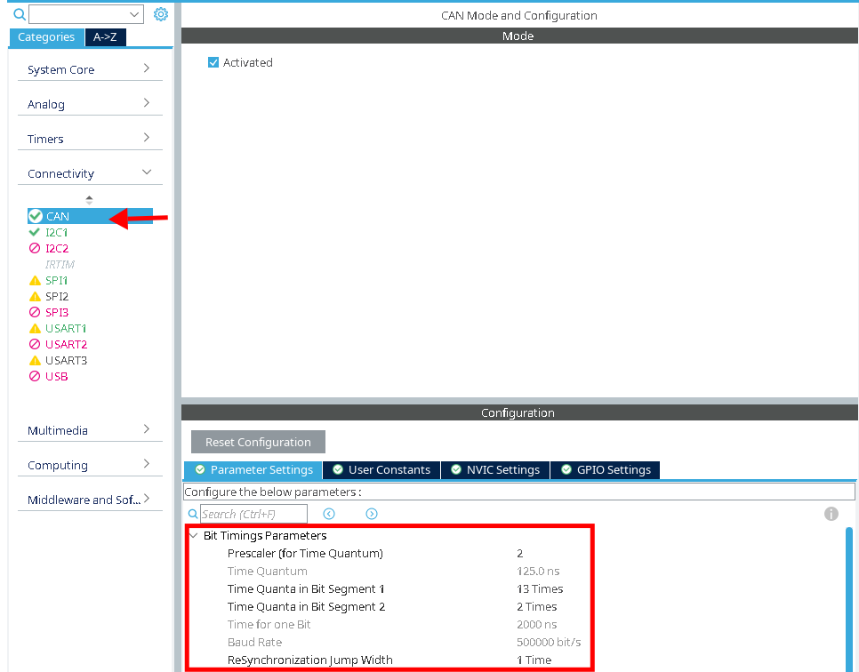
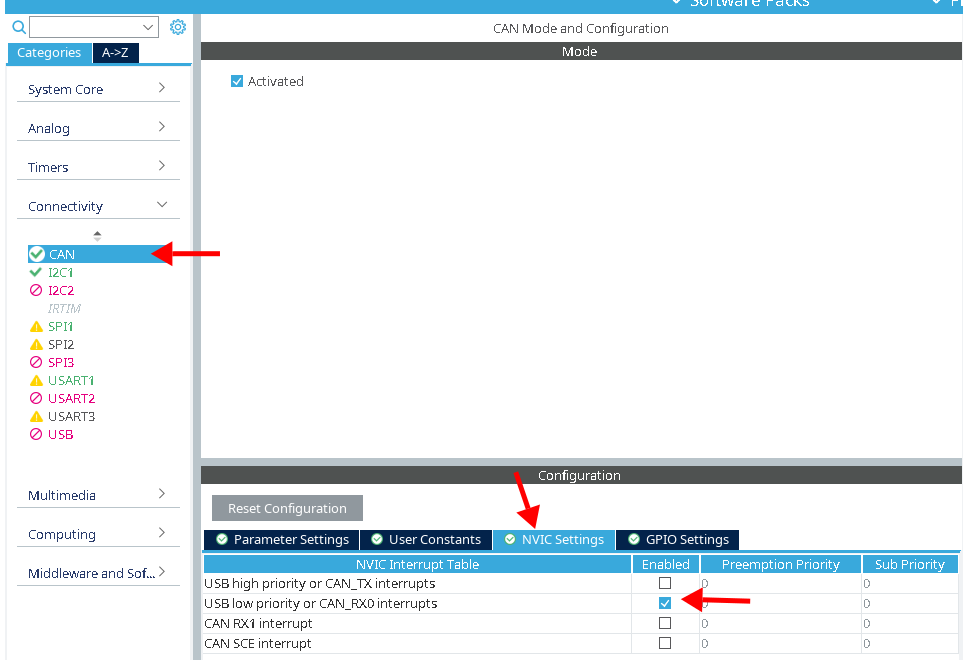
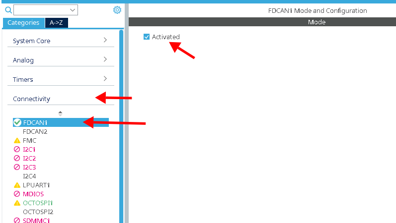
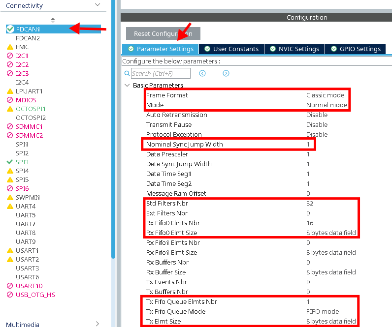
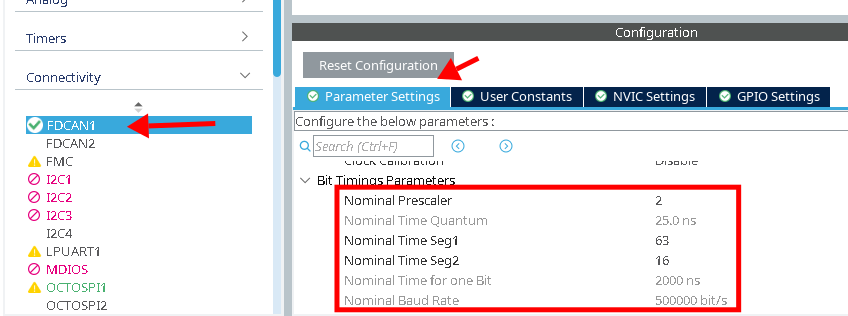
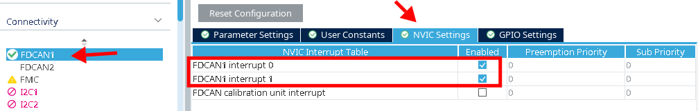

# FaSTTUBe CAN HAL Abstraction Layer

This repository contains an abstraction layer to provide a simplified & unified
interface to the STM32 bxCAN and FDCAN peripherals.

## Installation

Simply add the repository to your `Core/Lib` directory. You can also add it as a
git submodule:

    mkdir -p Core/Lib
    cd Core/Lib
    git submodule add ssh://git@git.fasttube.de:313/FaSTTUBe/can-halal.git

The library needs to be told what STM family you're using, so make sure one of
the following symbols is defined when `can-halal.c` is compiled or `can-halal.h`
is included:

- `STM32F3`
- `STM32H7`

When using the FDCAN peripheral (H7 series), you also need to define
`FTCAN_NUM_FILTERS` (and set it to the value of "Std Filters Nbr" you configured
in your `.ioc`).

If you use
[VSCode with the stm-32-for-vscode extension](https://podio.com/fasttubede/modulubergreifend/apps/tech-tutorials/items/57),
you can add these definitions in the `STM32-for-VSCode-config.yaml` file, e.g.:

```yaml
# Compiler definitions. The -D prefix for the compiler will be automatically added.
cDefinitions:
  - STM32H7
  - FTCAN_NUM_FILTERS=32
```

## Usage

1. Include `can-halal.h`
2. Call `ftcan_init()` with the appropriate handle
3. Call `ftcan_add_filter()` with all your filters
4. To transmit messages, call `ftcan_transmit()`
5. When a message is received, `ftcan_msg_received_cb()` is called. It has a
   default empty implementation, which you can simply override.

## Enabling CAN in STM32CubeMX

This isn't specific to `can-halal`, but for completeness sake is included here.

### bxCAN (e.g. STM32F3xx)

1. Enable the CAN peripheral  
   
2. Setup the [bit timings](http://bittiming.can-wiki.info/).  
   **Note:** the baud rate depends on your system clock, so make sure that is
   setup correctly first!  
   
3. Make sure the CAN_RX0 interrupt is enabled  
   

### FDCAN (e.g. STM32H7xx)

1. Enable the CAN peripheral  
   
2. Setup the frame format, nominal SJW, filters, and FIFOs. The numbers for
   filters/FIFOs in the screenshot are examples.  
   **Note:** You need to tell `can-halal` about the number of filters by
   defining `FTCAN_NUM_FILTERS` (see above).  
   
3. Setup the [bit timings](http://bittiming.can-wiki.info/). We only use CAN in
   classic mode, not FD mode, so we only need to worry about the nominal bit
   timings  
   **Note:** the baud rate depends on your system clock, so make sure that is
   setup correctly first!  
   
4. Make sure the interrupts are enabled
   
