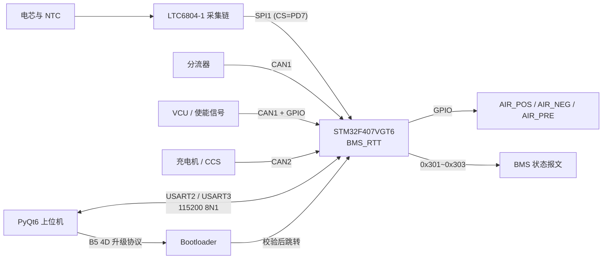
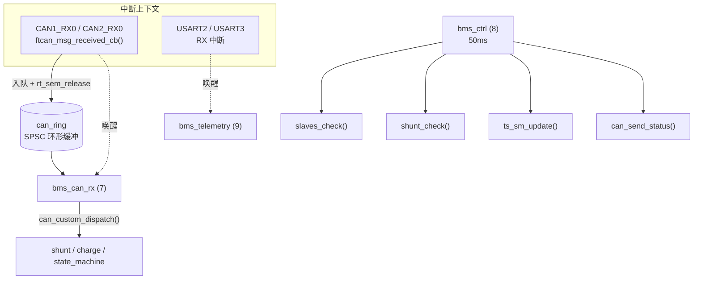
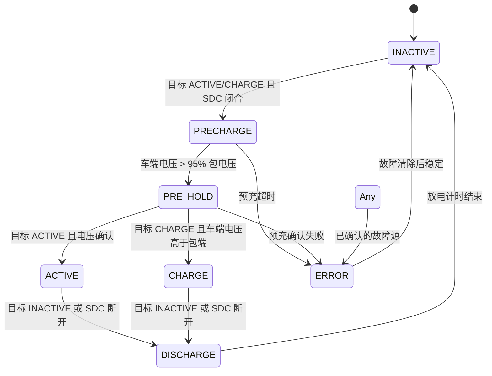

# BMS_RTT

一套运行在 **STM32F407VGT6** 上的电池管理系统（BMS）应用固件，基于 **RT-Thread 3.1.3** 实时内核，采用多线程模型完成电芯/温度采集、分流器与整车 CAN 数据处理、故障保护、高压继电器时序控制、串口遥测与固件在线升级（IAP）。

本工程面向电动车 / 储能电池包场景：通过 LTC6804-1 采集链读取单体电压与 NTC 温度，通过 CAN 接收分流器与整车/充电机报文，通过 GPIO 驱动正/负/预充三路 AIR 继电器，并通过双串口与上位机交互。

---

## 目录

- [系统概览](#系统概览)
- [RT-Thread 线程模型](#rt-thread-线程模型)
- [硬件与外设映射](#硬件与外设映射)
- [通信接口](#通信接口)
- [保护与状态机](#保护与状态机)
- [Flash 布局与在线升级](#flash-布局与在线升级)
- [构建](#构建)
- [烧录与交付物](#烧录与交付物)
- [上位机](#上位机)
- [目录结构](#目录结构)
- [当前配置与已知边界](#当前配置与已知边界)
- [相关文档](#相关文档)

---

## 系统概览



软件分三层：

| 层 | 内容 |
| --- | --- |
| 驱动层 | CubeMX/HAL 生成的 GPIO、CAN1/CAN2、SPI1/SPI3、USART2/USART3；`Hardware/LTC6804-1/`（AFE 驱动）；`Hardware/can-halal/`（双 bxCAN 适配） |
| 采集与估算层 | `slave_monitor.c`（AFE/温度）、`shunt_monitor.c`（分流器）、`soc_estimation.c`（SOC） |
| 保护与控制层 | `state_machine.c` + `state_machine_core.c`（状态机与 AIR 时序）、`can_custom.c`（CAN 收发分发）、`telemetry_serial.c`（串口协议） |

### 与同源裸机版的关系

本工程与同源的**裸机版**共用同一套业务源码。17 个业务文件（`bms_io`、`can_custom`、`shunt_monitor`、`slave_monitor`、`soc_estimation`、`state_machine`、`state_machine_core`、`telemetry_serial` 及其头文件）在两版之间**逐字节相同**，差异只在编译期由 `BMS_USE_RTTHREAD` 宏切换：

- 定义时（本工程）→ 锁为 `rt_mutex`（递归 + 优先级继承），日志格式化走 `rt_vsnprintf`，字符出口为 `rt_hw_console_output()`。
- 未定义时（裸机版）→ 锁为空实现（主循环单线程），日志走 `vsnprintf` + `HAL_UART_Transmit`。

这样做的目的是让"算法一份、调度两套"，业务逻辑的任何修改在两版之间可机械同步，不存在两份语义漂移的代码。

---

## RT-Thread 线程模型

内核配置：`RT_TICK_PER_SECOND = 1000`（1 ms 节拍），`RT_THREAD_PRIORITY_MAX = 32`。**优先级数值越小越高。**

| 线程 | 优先级 | 栈 | 触发方式 | 职责 |
| --- | ---: | ---: | --- | --- |
| `led_blink` | 15 | 512 B | 50 ms 周期 | 翻转 `STATUS_1` 心跳，兼作 RTOS 存活指示 |
| `bms_can_rx` | 7 | 1024 B | 信号量驱动（ISR 释放） | 排空 CAN 环形缓冲 → 逐帧分发（分流器 / 充电机 / 整车） |
| `bms_ctrl` | 8 | 1536 B | 50 ms 固定周期 | 状态机每拍推进；电芯采样 / 分流检查 / CAN 状态帧 / 回环自测按 1/3 分频（150 ms）执行 |
| `bms_telemetry` | 9 | 1280 B | 事件驱动 + 200 ms 兜底 | 串口收帧解析、周期遥测上报 |
| `main` | 10 | — | — | 初始化外设后调用 `bms_app_start()`，随后让出 CPU |



**关键设计：**

- **ISR 只入队，不做业务。** CAN 中断回调仅把帧写入 `can_ring`（写载荷 → `__DMB()` → 推进写索引），再 `rt_sem_release()` 唤醒 `bms_can_rx`。分发（可能持锁、可能发串口）全部在线程上下文完成。
- **CAN1_RX0 与 CAN2_RX0 必须保持同一 NVIC 优先级**，两者互不抢占，多来源入队才等效单生产者。改优先级即破坏该前提。
- **中断优先级收窄为 5**：`bms_app_start()` 把 CAN1_RX0 / CAN2_RX0 / USART2 / USART3 全部设为抢占优先级 5，避免消息风暴时长时间压住最低优先级的 SysTick（RTOS 节拍）导致调度停摆。
- **绝不跨阻塞调用持锁**：`HAL_UART_Transmit`、`rt_thread_mdelay` 一律在 `bms_state_lock` 之外执行。
- **时基**：HAL 的 `uwTick` 由 **TIM7** 提供（1 ms），RTOS 节拍由 **SysTick** 提供。`main()` 在 `SystemClock_Config()` 之后会按实际 `SystemCoreClock` 重装 `SysTick->LOAD`——RT-Thread 的 `rt_hw_board_init()` 在 PLL 配置前按 HSI 频率装过一次，不重装则所有 `rt_thread_mdelay` 会按错误比例缩水。

---

## 硬件与外设映射

| 外设 | 引脚 | 用途 |
| --- | --- | --- |
| CAN1 | PA11 / PA12 | 分流器（`0x52x`）、整车 `0x700` / `0x188` |
| CAN2 | PB12 / PB13 | BMS 状态输出、充电机 CCS 扩展帧 |
| SPI1 | SCK/MISO/MOSI + **CS = PD7** | LTC6804-1 采集链 |
| USART2 | PA2 / PA3 | 上位机 / 调试主口 |
| USART3 | PB10 / PB11 | 第二上位机口 |

### 数字输入输出

| 信号 | 引脚 | 方向 | 说明 |
| --- | --- | --- | --- |
| `POWER_UP` | PE2 | 输入 | 上电/使能 |
| `CHARGE_ENABLE` | PE3 | 输入 | 充电使能 |
| `SDC_VOLTAGE` | PE4 | 输入 | SDC 联锁（闭合判定） |
| `POS_AIR` / `NEG_AIR` / `PRECHARGE` | PD11 / PD9 / PB15 | 输出 | 三路继电器控制 |
| `BMS_ERROR` / `BMS_NERROR` | PE5 / PB0 | 输出 | 硬线故障指示 |
| `HV_ACTIVE` / `HV_MISMATCH` | PE10 / PC4 | 输出 | 高压状态 |
| `STATUS_1`~`STATUS_6` | PC8 / PA7 / PC6 / PA6 / PD14 / PA5 | 输出 | 状态指示（见下） |

**状态指示约定**（两版一致）：

| LED | 含义 |
| --- | --- |
| `STATUS_1` | RTOS 心跳（`led_blink` 线程 50 ms 翻转） |
| `STATUS_2` | 本拍控制循环超支（未超支熄灭） |
| `STATUS_3` | 状态机非 `INACTIVE` |
| `STATUS_4` | AFE 通信错误（PEC 校验失败且有放电电流） |
| `STATUS_5` | 启动时 CAN 初始化失败 |
| `STATUS_6` | 存在故障 |

---

## 通信接口

### CAN 报文

| 方向 | 总线 | 标识符 | 用途 |
| --- | --- | --- | --- |
| 输入 | CAN1 | `0x521`~`0x528` | 分流器：电流、电压、母排温度、功率、计数器 |
| 输入 | CAN1 | `0x188` | VCU 驱动模式（超时 2 s 失效） |
| 输入 | CAN1 | `0x700` | 充电命令识别 |
| 输入 | CAN2 | `0x18FF50E5` | 充电机 CCS 扩展帧 |
| 输出 | CAN2 | `0x301` / `0x302` / `0x303` | BMS 状态 1/2/3 |
| 输出 | CAN2 | `0x1806E5F4` | 充电电压/电流请求 |

报文定义以 `DBC/BMS.dbc` 与 `DBC/IVT.dbc` 为权威。

### 串口协议

`USART2` 与 `USART3` 均为 **115200 8N1**，两个口都能跑完整协议（含 `0x13` 重入升级）。帧格式：

```text
B5 4D | version:u8 | type:u8 | sequence:u16 | payload_length:u16 | payload | crc16_modbus:u16
```

- 第一个收到合法帧的串口成为**活动链路**；上位机每 200 ms 发心跳，APP 在链路有效时以 200 ms 周期发布完整遥测；心跳超时 1 s 后释放链路。
- 遥测包含状态、错误码、控制模式、AIR/SDC/HV 状态、包/车端电压、电流、SOC、温度极值，以及电芯与温度数组。
- 命令包括：目标状态、手动 AIR、心跳、清故障、进入 Bootloader；均回 ACK。
- 上位机未连接时（无活动链路），APP 每 1 s 打印一行 `[ST]` 文本状态，方便纯串口逻辑验证。

---

## 保护与状态机

`state_machine.c` 是安全控制中心，维护当前状态、目标状态、故障位图 `ts_error_kind`，以及三路 AIR 输出。每类故障先经 `ErrorMonitor` 去抖（典型 500 ms / 1000 ms）确认后再汇入状态机；`ERROR_LATCH_ENABLE = 1` 时已确认故障会锁存，直至收到清错命令或复位重评。

| 状态 | 目的 | AIR_POS | AIR_NEG | AIR_PRE |
| --- | --- | ---: | ---: | ---: |
| `TS_INACTIVE` | 未激活 | 断 | 断 | 断 |
| `TS_PRECHARGE` | 预充 | 断 | 合 | 合 |
| `TS_PRE_HOLD` | 预充稳定确认 | 合 | 合 | 合 |
| `TS_ACTIVE` | 待驶 / 放电 | 合 | 合 | 断 |
| `TS_CHARGE` | 充电运行 | 合 | 合 | 断 |
| `TS_DISCHARGE` | 断开后等待放电 | 断 | 断 | 断 |
| `TS_ERROR` | 故障安全态 | 断 | 断 | 断 |



保护阈值当前为编译期宏，位于 `slave_monitor.h`（过压 4200 mV / 欠压 3200 mV / 过温 35 ℃）、`shunt_monitor.h` 与 `state_machine.h`。

> `state_machine_core.c` 是与 HAL/RTOS 无关的**纯决策内核**（只依赖 `<stdint.h>`/`<stdbool.h>`），因此可在宿主机上独立编译测试；`state_machine.c` 只负责真值快照、加锁与锁外执行动作。

---

## Flash 布局与在线升级

| 区域 | 地址 | 用途 |
| --- | --- | --- |
| Bootloader | `0x08000000`..`0x0800FFFF` | 启动校验与串口升级服务 |
| APP 镜像 | `0x08010000`..`0x080FFEFF` | 应用固件（本工程） |
| APP 元数据 | `0x080FFF00`..`0x080FFFFF` | 魔数、镜像长度、CRC32 及反码 |

**升级流程**：APP 收到 `0x13` 进入 Bootloader 命令 → 写 RTC 备份寄存器标志 + 软件复位 → Bootloader 检测到标志后忽略有效 APP，等待上位机 `HELLO` → `BEGIN`(length, CRC32) → 分包 `DATA` → `END` 校验整包 CRC32、初始栈地址与复位向量 → 写入元数据 → `RUN` 跳转。

只有 `END` 阶段全部校验通过才写入有效元数据。因此升级中途掉电后，Bootloader 不会启动不完整的 APP，而是停留在升级服务中等待合法握手。

> **元数据是硬门槛**：Bootloader 在 `0x080FFF00` 处校验 `app_metadata_t{magic=0xB00710AD, ~magic, image_length, image_crc32, ~image_crc32}`，且 `crc32_ieee(0x08010000, image_length)` 必须匹配。**CubeIDE 的 Run/下载按钮只烧 ELF，不含元数据**，直接烧录会通不过校验、APP 一个字节都不执行（串口完全静默）。请烧 `*_stlink.hex`，或用 `tools/package_app_image.py` 给裸 ELF 补元数据。

---

## 构建

**工具链**：`arm-none-eabi-gcc` + CMake (≥3.22) + Ninja。APP 与 Bootloader 是**两个独立的 CMake 工程**，仓库根目录没有总 `CMakeLists.txt`。

```sh
# 应用固件
cd APP
cmake --preset Debug
cmake --build --preset Debug --parallel

# Bootloader
cd ../Bootloader
cmake --preset Debug
cmake --build --preset Debug --parallel
```

Windows 下若使用 STM32CubeCLT，需把 `GNU-tools-for-STM32/bin` 与 `Ninja/bin` 加进 `PATH`（`.vscode/tasks.json` 已配好直接可用的任务）。

### 编译选项

| 选项 | 默认 | 说明 |
| --- | --- | --- |
| `BMS_AFE_STUB` | `OFF` | `OFF` = 编译真实 LTC6804 驱动 `Hardware/LTC6804-1/LTC68041.c`；`ON` = 用 `Core/Src/LTC68041_stub.c` 桩件（每芯 3700 mV）在无 AFE 的板上跑逻辑 |
| `BMS_TEST_HOOKS` | `OFF` | `ON` = 编入台架自测/故障注入钩子（CAN 回环自测、串口 `0x20`~`0x23` 命令、`bms_io_inject`/`shunt_inject`/`slaves_inject`/`charge_inject`）。量产保持 `OFF` |

> CMake 的 `option()` 改不动已有的 `CMakeCache.txt`。要切换开关必须显式传入，例如
> `cmake --preset Debug -DBMS_AFE_STUB=OFF`，否则会沿用旧缓存值（表现为产物字节完全不变，是个很隐蔽的坑）。
> 建议台架构建另开目录：`cmake --preset Debug -B build/Debug-hooks -DBMS_TEST_HOOKS=ON`。

---

## 烧录与交付物

`firmware_artifacts` 目标会依次产出：

| 文件 | 用途 |
| --- | --- |
| `BMS_RTT.elf` | 调试符号 / GDB |
| `BMS_RTT.bin` | **串口升级**（仅 APP，不含元数据） |
| `BMS_RTT_stlink.hex` | **ST-Link 直接烧录**（APP + 元数据） |

```sh
# ST-Link 烧 Bootloader（只在首次或更新引导时）
STM32_Programmer_CLI -c port=SWD mode=UR -w Bootloader.bin 0x08000000 -v -rst

# ST-Link 烧 APP（含元数据）
STM32_Programmer_CLI -c port=SWD mode=UR -w BMS_RTT_stlink.hex -v -rst
```

串口 IAP 升级由上位机的"固件升级"功能完成：先向 APP 发送 `0x13` 进入 Bootloader，再用 `BMS_RTT.bin` 走 HELLO/BEGIN/DATA/END/RUN 流程。

> `mode=UR` 每次连接都会复位目标；只想读寄存器/内存观察运行状态时用 `mode=hotplug`（不复位）。

---

## 上位机

`HostComputer/` 是基于 **PyQt6** 的上位机：接收二进制遥测，显示全部单体槽位（偶数分组第 12 槽为空位，显示 `N/A`）与温度，记录 CSV 日志，发送受保护的状态/继电器命令，并支持一键固件升级。

```sh
conda env create -f HostComputer/environment.yml
conda activate bms_pc

python -m bms_host              # 真实串口
python -m bms_host --simulate   # 模拟遥测
```

协议实现位于 `HostComputer/bms_host/protocol.py`，串口与升级流程位于 `serial_worker.py`。继电器手动控制模块解锁密码为 `sztu`。

---

## 目录结构

```text
BMS_RTT/
├── APP/                             应用固件（CMake 工程）
│   ├── Core/
│   │   ├── Src/                     main.c, bms_app.c, rt_app.c, 业务模块…
│   │   └── Inc/                     对应头文件
│   ├── Hardware/
│   │   ├── LTC6804-1/               AFE 驱动（真驱动）
│   │   └── can-halal/               双 bxCAN 适配层
│   ├── Middlewares/Third_Party/RealThread_RTOS_RT-Thread/   RT-Thread 内核
│   ├── RT-Thread/rtconfig.h         内核裁剪配置
│   ├── cmake/                       工具链 + CubeMX 生成的构建脚本
│   ├── CMakeLists.txt
│   └── CMakePresets.json
├── Bootloader/                      IAP 引导（独立 CMake 工程）
├── HostComputer/                    PyQt6 上位机
├── DBC/                             BMS.dbc / IVT.dbc
├── docs/                            构建与 ST-Link 下载说明
├── tools/package_app_image.py       打包 elf/bin/metadata/stlink.hex
├── SYSTEM_FRAMEWORK.md              系统框架详述
└── README.md
```

---

## 当前配置与已知边界

- **AFE 级联数** `TOTAL_IC = 12`（`slave_monitor.h`）。12 IC × 12 通道 − 6 个空位 = **138 个有效单体**；偶数编号 IC 的第 12 通道无电芯。变更硬件串数时需同步更新 `slave_monitor.h` 与遥测容量。
- **CAN 模式**在 `APP/Core/Src/can.c` 与 `.ioc` 中为 `CAN_MODE_NORMAL`。若总线上没有第二个节点，回环自测与分流器数据会失效（收不到 ACK → TEC 累积）；需要自测时改回 `CAN_MODE_LOOPBACK`，两处（源码 + `.ioc`）都要改，改完必须**重新 build + flash**。
- **AFE 真驱动**要求 `LTC6804_initialize()` 被调用（`bms_app_start()` 中已含）。真驱动下若板上未装 LTC6804，电芯读数会为 0，从而触发欠压保护。
- 保护阈值目前**只有编译期宏**，协议中暂无在线读写命令。
- `SYSTEM_FRAMEWORK.md` 描述的是系统框架，其中部分细节随版本演进可能滞后，**以源码为准**。

---

## 相关文档

| 文档 | 内容 |
| --- | --- |
| `SYSTEM_FRAMEWORK.md` | 系统分层、数据闭环、接口契约的完整说明 |
| `Bootloader/README.md` | 升级协议帧格式与命令序列 |
| `HostComputer/README.md` | 上位机环境、运行与打包 |
| `docs/Windows_VSCode_CMake_Toolchain.md` | Windows + VS Code + CMake 构建环境 |
| `docs/CubeIDE_STLink_APP_Download.md` | CubeIDE 下用 ST-Link 下载 APP 的注意事项 |
