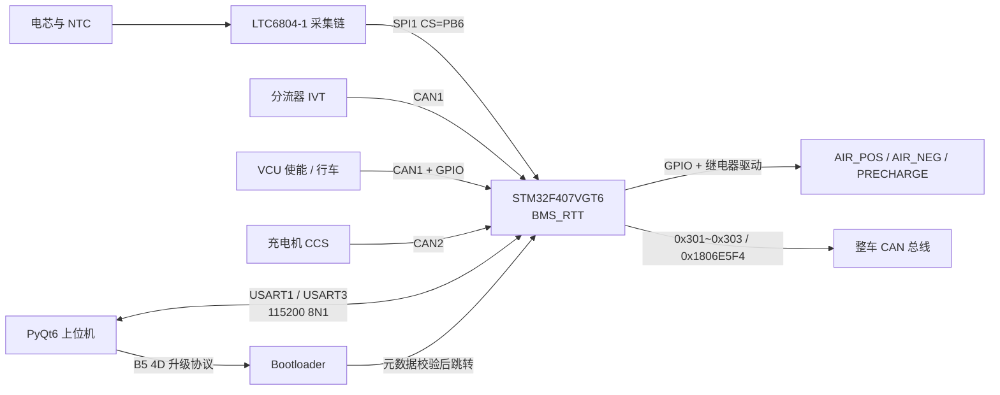
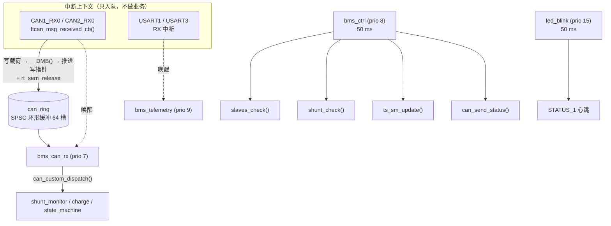
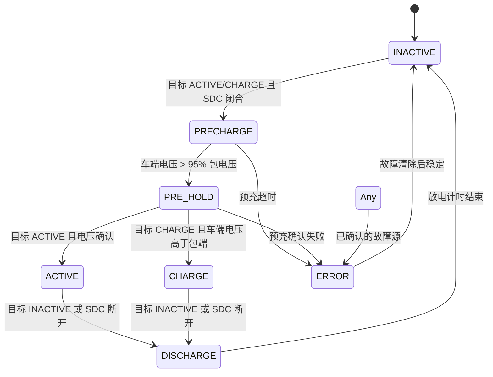

# BMS_RTT


面向电动车 / 储能电池包的 **BMS 主控固件**，跑在 **STM32F407VGT6** 上，基于 **RT-Thread 3.1.3** 实时内核。
多线程模型完成电芯与温度采集、分流器与整车 CAN 数据处理、SOC 估算、故障保护、高压继电器时序控制、
双串口遥测与固件在线升级（IAP）。

业务算法与同源**裸机版 BMS_V1.0** 逐条对齐（状态机判据、错误去抖、SOC 算法等直接取自 V1.0 新版）；
业务模块源码与裸机姊妹工程按 `BMS_USE_RTTHREAD` 宏共用一份，差异被收拢到调度与并发模型一层——
两版之间可以机械对照，不存在两份语义漂移的代码。

```text
LTC6804-1 采集链 ──SPI1──┐
分流器 / 整车 ───CAN1────┤──► STM32F407VGT6 ──GPIO──► AIR_POS / AIR_NEG / AIR_PRECHARGE
充电机 ──────────CAN2────┘        │  RT-Thread 3.1.3
上位机 ◄──USART1 / USART3──┘       └──CAN2──► 0x301 / 0x302 / 0x303 + 充电请求
```

---

## 快速开始

```sh
git clone https://github.com/Aurora-Electronic-BMS/BMS_RTT.git
cd BMS_RTT/APP
cmake --preset Debug
cmake --build --preset Debug --parallel     # 产出 build/Debug/BMS_RTT_stlink.hex
```

烧录、上位机与 IAP 细节见 [构建](#构建) / [烧录与交付物](#烧录与交付物) / [上位机](#上位机)。

---

## 目录

- [系统概览](#系统概览)
- [快速开始](#快速开始)
- [引脚映射](#引脚映射)
- [RT-Thread 设计](#rt-thread-设计)
- [与裸机版 BMS_V1.0 的技术区别](#与裸机版-bms_v10-的技术区别)
- [通信接口](#通信接口)
- [保护与状态机](#保护与状态机)
- [运行时配置与 Flash 持久化](#运行时配置与-flash-持久化)
- [Flash 布局与在线升级](#flash-布局与在线升级)
- [构建](#构建)
- [烧录与交付物](#烧录与交付物)
- [上位机](#上位机)
- [目录结构](#目录结构)
- [当前配置与已知边界](#当前配置与已知边界)
- [相关文档](#相关文档)

---

## 系统概览



软件分三层，层间只通过显式接口耦合：

| 层 | 文件 | 职责 |
| --- | --- | --- |
| 驱动层 | CubeMX/HAL 生成的 `gpio.c` / `can.c` / `spi.c` / `usart.c`；`Hardware/LTC6804-1/`（AFE 驱动）；`Hardware/can-halal/`（双 bxCAN 适配） | 寄存器与外设 |
| 采集与估算层 | `slave_monitor.c`（电压/温度 + PEC）、`shunt_monitor.c`（分流器）、`soc_estimation.c`（SOC） | 把原始数据变成物理量 |
| 保护与控制层 | `state_machine.c` + `state_machine_core.c`（决策内核 + AIR 时序）、`can_custom.c`（收发分发）、`telemetry_serial.c`（串口协议） | 决策与对外接口 |

**分层里最关键的一条**：`state_machine_core.c` 是**与 HAL/RTOS 完全无关的纯决策内核**
（只依赖 `<stdint.h>` / `<stdbool.h>`，输入一个真值快照、输出一组动作），因此可以在宿主机上
单独编译与穷举测试；`state_machine.c` 只负责取快照、加锁、以及**在锁外**执行动作。

---

## 引脚映射

引脚定义以 `APP/Core/Inc/main.h` 为唯一权威，本表与其逐项对应（与 BMS_V1.0 一致）。

### 通信外设

| 外设 | 引脚 | 用途 |
| --- | --- | --- |
| CAN1 | `PA11` / `PA12` | 分流器 IVT `0x52x`、整车请求充电 `0x700`、行车使能 `0x188` |
| CAN2 | `PB12` / `PB13` | BMS 状态帧发（`0x301`~`0x303`）、充电请求发、充电机 CCS 扩展帧收 |
| SPI1 | `PB3` SCK / `PB4` MISO / `PB5` MOSI / **CS `PB6`** | LTC6804-1 采集链 |
| SPI3 | `PC10` SCK / `PC11` MISO / `PC12` MOSI / **CS `PD0`** | 备用 SPI 通道 |
| USART1 | `PA9` / `PA10` | 上位机主口 / 调试打印（`rt_kprintf` 出口） |
| USART3 | `PB10` / `PB11` | 第二上位机口 |

### 数字输入

可被上位机串口注入覆盖的输入（`POWER_UP` / `CHARGE_ENABLE` / `SDC_VOLTAGE`）仅在
`BMS_TEST_HOOKS=ON` 时开放注入通道。

| 信号 | 引脚 | 方向 | 说明 |
| --- | --- | --- | --- |
| `POWER_UP` | `PE5` | 输入 | 上电 / 使能；**新版使能判据取此信号**（非 `CHARGE_ENABLE`） |
| `CHARGE_ENABLE` | `PE4` | 输入 | 充电使能 |
| `SDC_VOLTAGE` | `PE3` | 输入 | SDC 联锁，断开即退出 `ACTIVE`/`CHARGE` |

### 数字输出

| 信号 | 引脚 | 模式 | 说明 |
| --- | --- | --- | --- |
| `POS_AIR_CTRL` | `PD11` | 开漏 | 主正继电器 |
| `NEG_AIR_CTRL` | `PD9` | 开漏 | 主负继电器 |
| `PRECHARGE_CTRL` | `PB15` | 推挽 | 预充继电器 |
| `BMS_ERROR` | `PE2` | 开漏（**外部上拉**） | 故障硬线，拉高 = 有故障 |
| `BMS_NERROR` | `PB0` | 推挽 | 无故障指示，启动即拉高 |
| `ERROR_LED` | `PE8` | 推挽 | 错误灯 |
| `HV_ACTIVE` | `PE10` | 推挽 | 高压已建立 |
| `HV_MISMATCH` | `PC4` | 推挽 | 分流器电压与 AFE 总压失配 |
| `SPI1_CS` / `SPI3_CS` | `PB6` / `PD0` | 推挽（上拉，Very High） | AFE / 备用 SPI 片选，空闲拉高 |

### 状态指示灯

| LED | 引脚 | 含义 |
| --- | --- | --- |
| `STATUS_1` | `PC8` | RTOS 心跳：`led_blink` 线程 50 ms 翻转（兼作调度存活指示） |
| `STATUS_2` | `PC7` | 本拍控制循环超支（未超支熄灭） |
| `STATUS_3` | `PC6` | 状态机非 `INACTIVE` |
| `STATUS_4` | `PD15` | AFE 通信错误（PEC 校验失败且有充放电电流） |
| `STATUS_5` | `PD14` | 启动时 CAN 初始化失败 |
| `STATUS_6` | `PD13` | 存在故障 |

> 三路 AIR 与 `BMS_ERROR` / `BMS_NERROR` / `HV_ACTIVE` 由 `state_machine.c` 以**位掩码**
> 驱动（`out.pins.write & TS_PIN_xxx`），只在动作真正需要时才写引脚——这保证了与裸机版
> 在"预充超时进 ERROR 那一拍只写 NERROR、BMS_ERROR 不动"这类边界拍上行为逐拍等价。

---

## RT-Thread 设计

内核配置：`RT_TICK_PER_SECOND = 1000`（1 ms 节拍），`RT_THREAD_PRIORITY_MAX = 32`，
`RT_USING_SEMAPHORE` + `RT_USING_MUTEX` 使能。**优先级数值越小越高。**

### 线程

| 线程 | 优先级 | 栈 | 触发方式 | 职责 |
| --- | ---: | ---: | --- | --- |
| `bms_can_rx` | 7 | 1024 B | 信号量驱动（ISR 释放） | 排空 CAN 环形缓冲 → 逐帧分发（分流器 / 充电机 / 整车） |
| `bms_ctrl` | 8 | 1536 B | 50 ms 固定周期 | 状态机每拍推进；电芯采样 / 分流检查 / CAN 状态帧 / 回环自测按 1/3 分频（150 ms） |
| `bms_telemetry` | 9 | 1280 B | 事件驱动 + 200 ms 兜底 | 串口收帧解析、周期遥测上报 |
| `main` | 10 | — | — | `MX_*_Init()` 后调用 `bms_app_start()`，随后 `rt_thread_mdelay(1000)` 让出 CPU |
| `led_blink` | 15 | 512 B | 50 ms 周期 | 翻转 `STATUS_1` 心跳 |



### 关键设计

- **ISR 只入队，不做业务。** CAN 中断回调仅把帧写入 `can_ring`（写载荷 → `__DMB()` → 推进写索引），
  再 `rt_sem_release()` 唤醒 `bms_can_rx`。分发（可能持锁、可能触发串口发送）全部在线程上下文完成——
  这是相对裸机版最大的结构变化。
- **`CAN1_RX0` 与 `CAN2_RX0` 必须保持同一 NVIC 优先级。** 两者互不抢占，多来源入队才等效单生产者
  （SPSC）语义；改优先级即破坏该前提。
- **中断优先级统一收窄到 5。** `bms_app_start()` 把 `CAN1_RX0` / `CAN2_RX0` / `USART1` / `USART3`
  全部设为抢占优先级 5，避免消息风暴时长时间压住最低优先级的 SysTick（RTOS 节拍）导致调度停摆，
  同时保证中断里可以安全调用 `rt_sem_release()`。
- **两把锁，职责分开。** `bms_tx_lock` 串行化 UART 发送（日志与遥测共用同一物理串口），
  `bms_state_lock` 是**递归 + 优先级继承**的互斥锁，保护跨线程共享的业务状态
  （`shunt_data`、`ts_state`、`current_soc`）。递归是必需的：`bms_out()` 会在持锁路径里被嵌套调用。
  **铁律：绝不跨阻塞调用持锁**（`HAL_UART_Transmit`、`rt_thread_mdelay` 一律在锁外）。
- **时基分离。** HAL 的 `uwTick` 由 **TIM7** 提供（1 ms），RTOS 节拍由 **SysTick** 提供。
  `main()` 在 `SystemClock_Config()` 之后按实际 `SystemCoreClock` 重装 `SysTick->LOAD`——
  RT-Thread 的 `rt_hw_board_init()` 在 PLL 配置**之前**按 HSI 频率装过一次，
  不重装则所有 `rt_thread_mdelay` 会按倍率缩水（这是移植中最隐蔽的一类坑）。
- **锁内只做决策，锁外才执行。** `ts_sm_update()` 在锁内取一次性输入快照（保证同一拍看到自洽数据）、
  跑纯决策内核、发布状态；随后解锁，再执行引脚写、错误源置位等可能取锁或有副作用的动作。

---

## 与裸机版 BMS_V1.0 的技术区别

两版的**业务算法同源**（状态机、错误去抖、SOC、阈值与判据逐条对齐），差异集中在调度与并发模型：

| 维度 | 裸机版 BMS_V1.0 | 本工程 BMS_RTT |
| --- | --- | --- |
| 调度模型 | 单个 `while(1)` 超级循环，`LOOP_PERIOD = 150 ms` 统一节拍 | 4 个 RT-Thread 线程，50 ms 控制拍 + 150 ms 重活分频 |
| 控制拍频率 | 状态机 150 ms 一拍 | 状态机 **50 ms** 一拍（重活仍 150 ms），预充/故障判定响应更快 |
| CAN 接收 | `HAL_CAN_RxFifo0MsgPendingCallback()` 里**直接**调 `ftcan_msg_received_cb → shunt_handle_can_message()`，业务在 **ISR 上下文**执行 | ISR 只入 `can_ring`（SPSC）+ `rt_sem_release()`；业务在 `bms_can_rx` 线程执行 |
| 并发与锁 | 单线程，无需锁 | `shunt_data` / `ts_state` / `current_soc` 跨线程共享 → `bms_state_lock`（递归 + 优先级继承） |
| 串口发送 | 直接 `HAL_UART_Transmit()` | 同一份源码，字符出口换成 `rt_hw_console_output()`，并用 `bms_tx_lock` 串行化 |
| 延时 | `HAL_Delay()` 忙等阻塞 | `rt_thread_mdelay` / `rt_thread_delay`，让出 CPU |
| 时基 | HAL `uwTick`（SysTick） | HAL tick = **TIM7**；RTOS tick = **SysTick**（PLL 后重装 LOAD） |
| 中断优先级 | CubeMX 默认（0） | 收窄为 5，避免压住 SysTick |
| 心跳指示 | 主循环里 `TogglePin(STATUS_1)` | 独立 `led_blink` 线程（最低优先级）——顺带成为"调度没死锁"的活体指示 |
| 平台切换 | — | 业务源码由 `BMS_USE_RTTHREAD` 编译期切换锁/日志/延时实现 |

**为什么值得这么切**：裸机版把业务逻辑放在 CAN 中断里跑，中断时长随业务增长而不受控；
RTT 版把中断压缩成"入队 + 唤醒"，业务时长与执行优先级由此可控，
并且让 `bms_ctrl` 能以 50 ms 的节奏推进状态机，而不必等 150 ms 的重活周期。

---

## 通信接口

### CAN 报文

| 方向 | 总线 | 标识符 | 用途 |
| --- | --- | --- | --- |
| 收 | CAN1 | `0x521`~`0x528` | 分流器 IVT：电流、电压 ×3、母排温度、功率、电流/电能计数器 |
| 收 | CAN1 | `0x700` | 整车请求充电（`CHARGE_CMD_TIMEOUT = 1 s` 过期） |
| 收 | CAN1 | `0x188` | 行车使能（独立心跳看门狗，`drive_mode_timeout_ms`） |
| 收 | CAN2 | `0x18FF50E5` | 充电机 CCS 扩展帧 |
| 发 | CAN2 | `0x301` / `0x302` / `0x303` | BMS 状态 1/2/3（`0x302` 含包电压与 SOC） |
| 发 | CAN2 | `0x1806E5F4` | 充电电压 / 电流请求 |

> 分流器通道映射（对齐 BMS_V1.0）：**`0x522`(U1) = 电池侧总压**、`0x523`(U2) = 车辆侧、
> `0x524`(U3) = 未参与保护的第三路。总压通道取错会同时打歪预充判据（`veh > 0.95 × bat`）
> 与电压失配保护。

报文定义以 `DBC/BMS.dbc` 与 `DBC/IVT.dbc` 为权威。

### 串口协议

`USART1` 与 `USART3` 均为 **115200 8N1**，两口都能跑完整协议（含 `0x13` 重入升级）。

```text
B5 4D | version:u8 | type:u8 | sequence:u16 | payload_length:u16 | payload | crc16_modbus:u16
```

| type | 方向 | 含义 |
| --- | --- | --- |
| `0x01` | APP → 上位机 | 全量遥测（`TELEMETRY_TX_PERIOD = 200 ms`） |
| `0x02` | APP → 上位机 | ACK（`0` 成功 / `2` 长度错 / `3` 未知命令 / `4` 被拒绝） |
| `0x04` / `0x15` | APP → 上位机 | 配置查询应答 |
| `0x10` | 上位机 → APP | 设置目标状态 |
| `0x11` | 上位机 → APP | 手动 AIR（故障或 SDC 断开时拒绝使能；断开永远允许） |
| `0x12` | 上位机 → APP | 心跳（`LINK_TIMEOUT = 1 s`） |
| `0x13` | 上位机 → APP | 进入 Bootloader（写 RTC 备份寄存器 + 软复位） |
| `0x14` | 上位机 → APP | 清除故障 |
| `0x16` | 上位机 → APP | 写入配置（要求 `INACTIVE` 且三路 AIR 全开） |
| `0x17` | 上位机 → APP | 按开路电压强制刷新 SOC |
| `0x18` | 上位机 → APP | 软件复位 |
| `0x20`~`0x23` | 上位机 → APP | 台架钩子：注入数字输入、IO 快照、CAN 回环自测、故障注入（仅 `BMS_TEST_HOOKS=ON`） |

- 第一个收到合法帧的串口成为**活动链路**；链路有效期间 APP 以 200 ms 周期发布完整遥测，
  心跳超时 1 s 后释放。
- 遥测固定区含状态、错误位图、控制模式、AIR/SDC/HV 回读、包端与车端电压、电流、SOC、
  温度极值；随后是逐槽数组：**144 个单体槽位**（每槽 1 bit 有效位）+ **48 个温度槽位**。
- 上位机未连接时，APP 每 1 s 打印一行 `[ST]` 文本状态，便于纯串口逻辑验证。

---

## 保护与状态机

`state_machine.c` 是安全控制中心，维护当前状态、目标状态、故障位图 `ts_error_kind`，以及三路 AIR 输出。
每类故障先经 `ErrorMonitor` 去抖（时长由配置项给出，典型 500 ms / 1000 ms）确认后再汇入状态机；
已确认故障会在配置允许时锁存，直至收到清错命令或复位重评。

| 状态 | 目的 | AIR_POS | AIR_NEG | AIR_PRE |
| --- | --- | ---: | ---: | ---: |
| `TS_INACTIVE` | 未激活 | 断 | 断 | 断 |
| `TS_PRECHARGE` | 预充 | 断 | 合 | 合 |
| `TS_PRE_HOLD` | 预充稳定确认 | 合 | 合 | 合 |
| `TS_ACTIVE` | 待驶 / 放电 | 合 | 合 | 断 |
| `TS_CHARGE` | 充电运行 | 合 | 合 | 断 |
| `TS_DISCHARGE` | 断开后等待放电 | 断 | 断 | 断 |
| `TS_ERROR` | 故障安全态 | 断 | 断 | 断 |



### 三类控制模式

| 模式 | 来源 | 说明 |
| --- | --- | --- |
| GPIO | 默认 | 由 `POWER_UP` / `CHARGE_ENABLE` / SDC + CAN 命令自然驱动 |
| 串口目标 | `0x10` | 上位机直接指定目标状态 |
| 手动 AIR | `0x11` | 上位机直接给三路继电器位图，**仅用于台架调试** |

> 手动 AIR 的**使能**方向带护栏：故障未清或 SDC 断开时直接拒绝（返回 `ACK_REJECTED`）；
> **断开**方向永不加护栏——任何时候都必须能断开继电器。

---

## 运行时配置与 Flash 持久化

保护阈值与时序参数**不是编译期常量**，而是运行时可读写的 `BmsConfig`（30 个字段），
由上位机经 `0x16` 写入、`0x15` 读回，掉电保持在 Sector 10 的追加记录区。

| 类别 | 字段（示例） |
| --- | --- |
| 拓扑 | `total_ic`（1..`BMS_MAX_IC`，默认 12） |
| 时序 | `air_close_wait_ms`、`precharge_95_wait_time_ms`、`pre_hold_time_ms`、`discharge_duration_ms`、`drive_mode_timeout_ms` |
| 分流器 | `shunt_timeout_ms`、`shunt_overcurrent_discharge_mA` / `_charge_mA` / `_regen_mA`、`shunt_overtemp_dC` |
| 电芯 | `max_cell_volt_mV` / `min_cell_volt_mV`、`max_cell_temp_C` / `min_cell_temp_C`、`pec_current_threshold_mA` |
| 充电 | `max_charge_volt_dV`、`max_charge_curr_dA` |

设计要点：

- 启动时 `bms_config_init()` 从 flash 载入并校验；**必须在 CAN 初始化之前调用**，
  它内部会把阈值与去抖时长刷新进 8 个故障监视器，并置 `flash_layout_ready`
  （决定 SOC / 配置能否落盘）。
- 写入路径 `0x16` 要求状态机为 `INACTIVE` 且三路 AIR 全开——即高压未建立时才允许改配置。
- 记录采用**追加写 + 满则整扇区擦除重写**。STM32F407VG 是**单 bank**，擦 Sector 10
  会冻结所有从 flash 取指的代码（含中断）达秒级，因此**整擦只在安全窗口（`INACTIVE`、
  三路 AIR 全开）执行**，否则挂起等下个安全拍补写；普通追加写不受此限。

> SOC 也落在这片记录区（变化 ≥1%、到 0/100%、或退出行车且断开高压时写一槽），
> 复用同一套"延后整擦"策略。

---

## Flash 布局与在线升级

| 区域 | 地址 | 用途 |
| --- | --- | --- |
| Bootloader | `0x08000000`..`0x0800FFFF` | 启动校验与串口升级服务 |
| APP 镜像 | `0x08010000`..`0x080FFEFF` | 应用固件（本工程） |
| APP 元数据 | `0x080FFF00`..`0x080FFFFF` | 魔数、镜像长度、CRC32 及各自反码 |

**升级流程**：APP 收到 `0x13` → 写 RTC 备份寄存器标志 + 软件复位 → Bootloader 检测到标志后
忽略有效 APP，等待上位机 `HELLO` → `BEGIN(length, CRC32)` → 分包 `DATA` →
`END` 校验整包 CRC32、初始栈地址与复位向量 → 写入元数据 → `RUN` 跳转。

只有 `END` 阶段全部校验通过才写入有效元数据。因此升级中途掉电后，Bootloader 不会启动不完整的
APP，而是停留在升级服务中等待合法握手。

> **元数据是硬门槛**：Bootloader 在 `0x080FFF00` 校验
> `app_metadata_t{magic=0xB00710AD, ~magic, image_length, image_crc32, ~image_crc32}`，
> 且 `crc32_ieee(0x08010000, image_length)` 必须匹配。
> **CubeIDE 的 Run / 下载按钮只烧 ELF，不含元数据**——直接烧录会通不过校验，
> APP 一个字节都不执行（串口完全静默）。请烧 `*_stlink.hex`，
> 或用 `tools/package_app_image.py` 给裸 ELF 补元数据。

---

## 构建

**工具链**：`arm-none-eabi-gcc` + CMake (≥3.22) + Ninja。
APP 与 Bootloader 是**两个独立的 CMake 工程**，仓库根目录没有总 `CMakeLists.txt`。

```sh
# 应用固件
cd APP
cmake --preset Debug
cmake --build --preset Debug --parallel

# Bootloader
cd ../Bootloader
cmake --preset Debug
cmake --build --preset Debug --parallel
```

Windows 下若使用 STM32CubeCLT，需把 `GNU-tools-for-STM32/bin` 与 `Ninja/bin` 加进 `PATH`
（`.vscode/tasks.json` 已配好可直接调用的任务）。

### 编译选项

| 选项 | 默认 | 说明 |
| --- | --- | --- |
| `BMS_AFE_STUB` | `OFF` | `OFF` = 编译真实 LTC6804 驱动；`ON` = 用 `Core/Src/LTC68041_stub.c` 桩件（每芯固定 3700 mV）在无 AFE 的板上跑逻辑 |
| `BMS_TEST_HOOKS` | `OFF` | `ON` = 编入台架自测 / 故障注入钩子（CAN 回环自测、串口 `0x20`~`0x23`、`bms_io_inject` / `shunt_inject` / `slaves_inject` / `charge_inject`） |

> CMake 的 `option()` 改不动已有的 `CMakeCache.txt`。要切换开关必须显式传入，
> 例如 `cmake --preset Debug -DBMS_AFE_STUB=OFF`，否则会沿用旧缓存值
> （表现为产物字节完全不变，是个很隐蔽的坑）。
> 建议台架构建另开目录：`cmake --preset Debug -B build/Debug-hooks -DBMS_TEST_HOOKS=ON`。

---

## 烧录与交付物

`firmware_artifacts` 目标依次产出：

| 文件 | 用途 |
| --- | --- |
| `BMS_RTT.elf` | 调试符号 / GDB |
| `BMS_RTT.bin` | **串口升级**（仅 APP，不含元数据） |
| `BMS_RTT.metadata.bin` | 元数据块，供工具链单独烧写 |
| `BMS_RTT_stlink.hex` | **ST-Link 直接烧录**（APP + 元数据） |

```sh
# ST-Link 烧 Bootloader（仅在首次或更新引导时）
STM32_Programmer_CLI -c port=SWD mode=UR -w Bootloader.bin 0x08000000 -v -rst

# ST-Link 烧 APP（含元数据）
STM32_Programmer_CLI -c port=SWD mode=UR -w BMS_RTT_stlink.hex -v -rst
```

串口 IAP 升级由上位机的"固件升级"功能完成：先向 APP 发送 `0x13` 进入 Bootloader，
再用 `BMS_RTT.bin` 走 HELLO / BEGIN / DATA / END / RUN 流程。

> `mode=UR` 每次连接都会复位目标；只想读寄存器 / 内存观察运行状态时用 `mode=hotplug`（不复位）。

---

## 上位机

`HostComputer/` 是基于 **PyQt6** 的上位机：接收二进制遥测，显示全部单体槽位
（偶数分组第 12 槽为空位，显示 `N/A`）与温度，记录 CSV 日志，发送受保护的状态 / 继电器命令，
并支持一键固件升级。

```sh
conda env create -f HostComputer/environment.yml
conda activate bms_pc

python -m bms_host              # 真实串口
python -m bms_host --simulate   # 模拟遥测
```

协议实现位于 `HostComputer/bms_host/protocol.py`，串口与升级流程位于 `serial_worker.py`。
继电器手动控制模块解锁密码为 `sztu`。

---

## 目录结构

```text
BMS_RTT/
├── APP/                             应用固件（独立 CMake 工程）
│   ├── Core/
│   │   ├── Src/                     main.c, bms_app.c, rt_app.c, 业务模块…
│   │   └── Inc/                     对应头文件（main.h 是引脚权威定义）
│   ├── Hardware/
│   │   ├── LTC6804-1/               AFE 驱动（真驱动）
│   │   └── can-halal/               双 bxCAN 适配层
│   ├── Middlewares/Third_Party/RealThread_RTOS_RT-Thread/   RT-Thread 3.1.3 内核
│   ├── RT-Thread/rtconfig.h         内核裁剪配置
│   ├── cmake/                       工具链 + CubeMX 生成的构建脚本
│   ├── CMakeLists.txt
│   └── CMakePresets.json
├── Bootloader/                      IAP 引导（独立 CMake 工程）
├── HostComputer/                    PyQt6 上位机
├── DBC/                             BMS.dbc / IVT.dbc
├── docs/                            构建与 ST-Link 下载说明
├── tools/package_app_image.py       打包 elf / bin / metadata / stlink.hex
├── training/state-machine-visualization/   状态机可视化（HTML）
├── SYSTEM_FRAMEWORK.md              系统框架详述
└── README.md
```

---

## 当前配置与已知边界

- **AFE 级联数** 由 `bms_config.total_ic` 决定（默认 12，上限 `BMS_MAX_IC = 12`）。
  12 IC × 12 通道 − 6 个空位（偶数编号 IC 的第 12 通道无电芯）= **138 个有效单体**。
  变更硬件串数时改配置即可，无需改代码。
- **CAN 模式**在 `APP/Core/Src/can.c` 与 `.ioc` 中为 `CAN_MODE_NORMAL`。若总线上没有第二个
  节点，回环自测与分流器数据会失效（收不到 ACK → TEC 累积）；需要自测时改回 `CAN_MODE_LOOPBACK`，
  两处（源码 + `.ioc`）都要改，改完必须**重新 build + flash**。
- **AFE 真驱动**要求 `LTC6804_initialize()` 被调用（`bms_app_start()` 中已含）。
  真驱动下若板上未装 LTC6804，电芯读数会为 0，从而触发欠压保护。
- **`.ioc` 重新生成**会覆盖 CubeMX 生成区。所有手改（CAN 波特率覆盖、`bms_config_init()` 调用
  顺序等）都放在 `/* USER CODE BEGIN/END */` 区内，重新生成不会丢失；但**不要**把改动手写在
  生成区（`MX_*_Init` 函数体、`HAL_*_MspInit`）。
- `SYSTEM_FRAMEWORK.md` 描述的是系统框架，其中部分细节随版本演进可能滞后，**以源码为准**。

---

## 相关文档

| 文档 | 内容 |
| --- | --- |
| `SYSTEM_FRAMEWORK.md` | 系统分层、数据闭环、接口契约的完整说明 |
| `Bootloader/README.md` | 升级协议帧格式与命令序列 |
| `HostComputer/README.md` | 上位机环境、运行与打包 |
| `docs/Windows_VSCode_CMake_Toolchain.md` | Windows + VS Code + CMake 构建环境 |
| `docs/CubeIDE_STLink_APP_Download.md` | CubeIDE 下用 ST-Link 下载 APP 的注意事项 |
