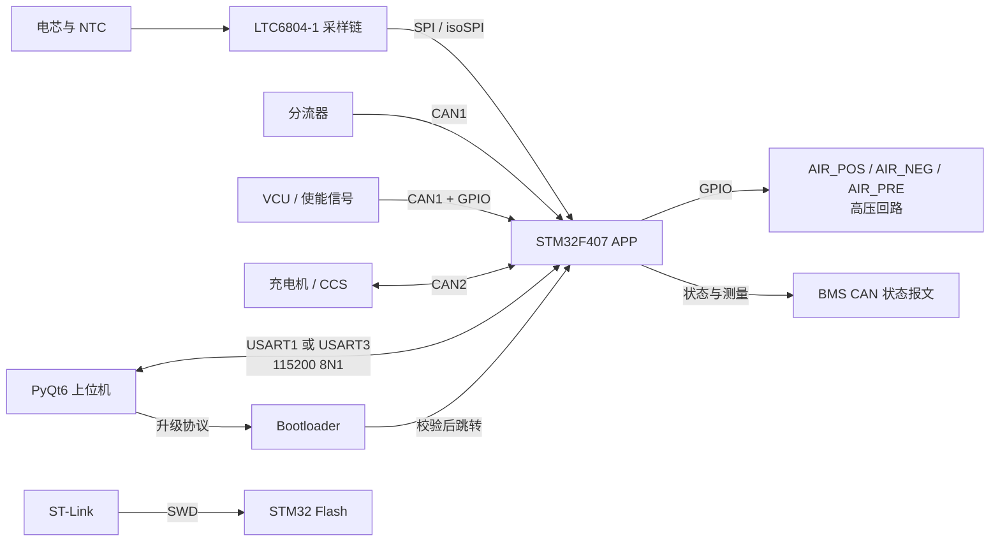
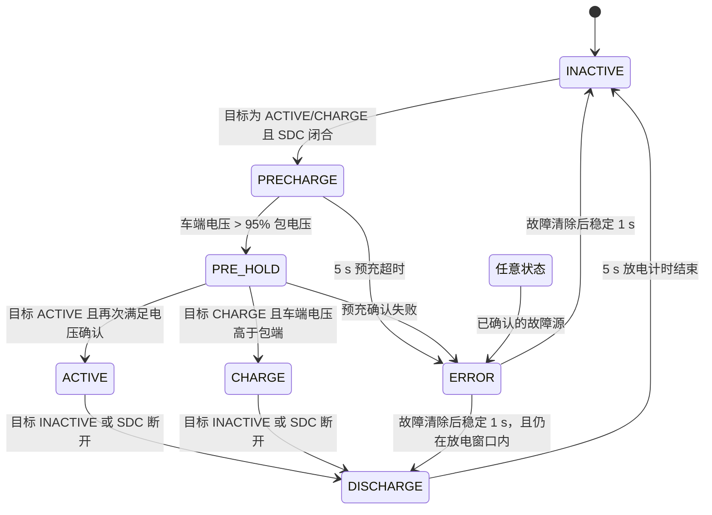
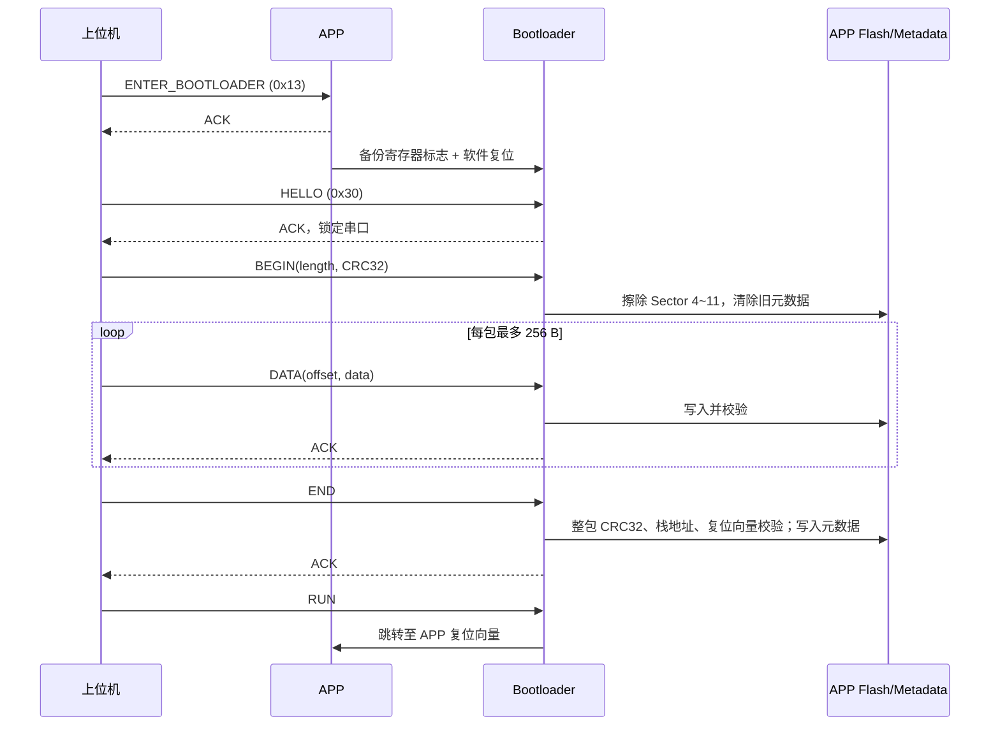

# BMS 软件系统框架

> 本文依据当前仓库源码整理，描述软件系统的组成、边界、数据与控制关系；它不是硬件原理图或功能安全认证文件。除特别说明外，模块与行为均以 `APP/`、`Bootloader/`、`HostComputer/` 中的当前实现为准。

## 1. 系统定位与边界

本工程是一套以 **STM32F407VGT6** 为核心的电池管理系统（BMS）软件，服务于电动车或储能电池包场景。软件的核心任务是：采集电芯与温度数据，接收分流器及整车/充电侧 CAN 数据，执行故障监测和高压继电器时序控制，并向 CAN 与上位机提供状态、遥测、控制和在线升级能力。

系统由三个独立可构建/运行单元组成：

| 单元 | 目录 | 承担的系统职责 |
| --- | --- | --- |
| BMS 应用固件（APP） | `APP/` | 实时采集、监测、状态机、高压继电器控制、CAN 报文、串口遥测与 APP 侧升级请求 |
| Bootloader | `Bootloader/` | 启动 APP 前的有效性校验，以及双串口在线升级、写 Flash 和升级掉电保护 |
| 上位机 | `HostComputer/` | PyQt6 监控界面、串口协议、CSV 记录、受控调试命令与 APP 在线升级客户端 |

系统外部边界包括：电芯采样链、NTC 温度输入、分流器、VCU/充电机、三路 AIR 继电器与 SDC/POWER_UP 等 GPIO 信号、串口上位机和 ST-Link 调试器。



## 2. 软件分层与职责

### 2.1 MCU 基础与驱动层

- CubeMX/HAL 生成的外设初始化位于 `APP/Core/Src/`：GPIO、CAN1/CAN2、SPI1/SPI3、USART1/USART3、时钟和中断。
- `APP/Hardware/LTC6804-1/` 封装 LTC6804-1 的电芯电压与辅助通道访问。
- `APP/Hardware/can-halal/` 为双 bxCAN 提供初始化、过滤、收发和回调适配。
- APP 采用 HAL `SysTick` 作为所有延时、超时和故障去抖的时间基准。

### 2.2 采集与估算层

| 模块 | 主要输入 | 核心输出 | 实现位置 |
| --- | --- | --- | --- |
| 从控/AFE 监测 | LTC6804 电芯码、GPIO/NTC 码、PEC 状态 | 单体极值、温度极值、包电压 `Bat_Volt`、从控故障源 | `slave_monitor.c` |
| 分流器监测 | CAN1 的 `0x521`~`0x528` | 电流、包/车端电压、母排温度、功率/能量、分流器故障源 | `shunt_monitor.c` |
| SOC 估算 | 最低单体电压、分流器电流积分 | `current_soc` | `soc_estimation.c` |

三个监测模块均已接入运行闭环：`slave_monitor.c`、`shunt_monitor.c` 由控制线程按 150 ms 分频调用，`soc_estimation.c` 的 `soc_init()`/`soc_update()` 在 `bms_app_start()` 与控制线程中调用，`current_soc` 并已纳入串口遥测。上电时 `bms_config_init()` 先于其余初始化执行，从 Sector 10 载入持久化配置与 SOC。

### 2.3 保护与状态控制层

`state_machine.c` 是 APP 的安全控制中心，维护：

- 当前状态、目标状态和故障源位图：`ts_state`；
- 细分故障码：`ts_error_kind`；
- 三个继电器输出：`AIR_POS`、`AIR_NEG`、`AIR_PRE`；
- 控制来源：GPIO 自动控制、串口目标状态控制、串口手动 AIR 控制。

每类故障条件先经 `ErrorMonitor` 去抖确认，再汇入状态机。当前的去抖时间为：分流器超时/过流 500 ms；电芯过压/欠压、通信、母排温度、压差以及从控过温 1000 ms。`ERROR_LATCH_ENABLE` 当前为 `1`，已确认的故障会锁存，直至发送 `CLEAR_ERRORS` 或复位后重新评估；若物理故障仍在，监测器将在后续扫描中再次置位。

状态与继电器关系如下：

| 状态 | 目的 | AIR_POS | AIR_NEG | AIR_PRE |
| --- | --- | ---: | ---: | ---: |
| `TS_INACTIVE` | 未激活 | 断开 | 断开 | 断开 |
| `TS_PRECHARGE` | 预充 | 断开 | 闭合 | 闭合 |
| `TS_PRE_HOLD` | 预充稳定确认 | 闭合 | 闭合 | 闭合 |
| `TS_ACTIVE` | 正常放电/待驶 | 闭合 | 闭合 | 断开 |
| `TS_CHARGE` | 充电运行 | 闭合 | 闭合 | 断开 |
| `TS_DISCHARGE` | 断开后等待放电 | 断开 | 断开 | 断开 |
| `TS_ERROR` | 故障安全态 | 断开 | 断开 | 断开 |



自动模式中，GPIO `POWER_UP` 和 CAN 命令共同决定目标状态：`POWER_UP` 有效且检测到充电命令时目标为 `TS_CHARGE`，否则为 `TS_ACTIVE`。CAN `0x188` 的驱动模式用于故障确认逻辑中的特定抑制条件；若其报文超时 2 s，驱动模式会失效。

## 3. APP 运行节拍与数据闭环

APP 初始化 CAN、SPI、两路串口和各功能模块后，主循环按以下顺序运行：

```text
处理串口接收帧
  → 采集/评估 AFE 与温度
  → 评估分流器数据与通信时效
  → 更新状态机与 AIR 输出
  → 发送 3 条 BMS CAN 状态报文
  → 按心跳条件发送串口遥测
  → 循环节拍控制（目标 150 ms）
```

因此，故障检测、状态控制和 CAN 发布均在同一串行主循环内完成；实际单轮周期还受 LTC6804 访问、CAN 发送和阻塞式串口发送影响。`LOOP_PERIOD` 的 150 ms 是目标下限控制，并不等同于经硬件实测的严格实时周期。

## 4. 通信框架

### 4.1 CAN 网络

CAN1 面向测量与整车输入，CAN2 面向充电侧以及 BMS 状态输出。当前 `can_custom.h` 定义的主要报文如下：

| 方向 | 总线 | 报文/标识符 | 用途 |
| --- | --- | --- | --- |
| 输入 | CAN1 | `0x521`~`0x528` | 分流器电流、电压、母排温度、功率、计数器等 |
| 输入 | CAN1 | `0x700` | 充电命令识别 |
| 输入 | CAN1 | `0x188` | VCU 驱动模式 |
| 输入 | CAN2 | `0x18FF50E5` | CCS 充电机报文 |
| 输出 | CAN2 | `0x301`、`0x302`、`0x303` | BMS 状态、继电器/故障与电流 |
| 输出 | CAN2 | `0x1806E5F4` | 充电电压/电流请求 |

DBC 文件位于 `DBC/BMS.dbc` 与 `DBC/IVT.dbc`，是报文字段解释的权威工程文件。

### 4.2 上位机串口协议

APP 和 Bootloader 都支持 `USART1`、`USART3`，配置为 **115200 8N1**。帧使用相同的基本封装：

```text
B5 4D | version:u8 | type:u8 | sequence:u16 | payload_length:u16 | payload | CRC16/Modbus:u16
```

- APP：第一个收到合法帧的串口成为活动链路；上位机每 200 ms 发送心跳，APP 在链路有效时以 200 ms 周期发布完整遥测；心跳超时 1 s 后释放该链路。
- 遥测包含状态、错误码、控制模式、AIR 状态、SDC/HV 状态、包/车端电压、电流、温度极值及电芯/温度数组。
- APP 接受目标状态、手动 AIR、心跳、清故障和进入 Bootloader 等命令；命令回复 ACK。
- 上位机协议实现和帧解析位于 `HostComputer/bms_host/protocol.py`，串口收发与升级流程位于 `serial_worker.py`。

### 4.3 上位机功能边界

PyQt6 上位机提供串口连接、运行指标、单体/温度视图、故障显示、CSV 日志、目标状态请求、手动 AIR 调试、清故障以及固件升级。它可用 `--simulate` 启动模拟遥测，但模拟模式不等同于对 MCU、CAN 或高压硬件的验证。

## 5. 启动、镜像与在线升级框架

Flash 布局将启动与应用分离：

| 区域 | 地址 | 用途 |
| --- | --- | --- |
| Bootloader | `0x08000000..0x0800FFFF`（Sector 0~3） | 启动校验与升级服务 |
| APP 镜像 | `0x08010000..0x080FFEFF` | 应用固件 |
| APP 元数据 | `0x080FFF00..0x080FFFFF` | 魔数、长度、CRC32 及反码 |



升级只有在 `END` 阶段通过完整镜像 CRC32、初始栈地址和复位向量校验后才写入有效元数据。因此升级中断电后，Bootloader 不会启动未完成的 APP，而是保留在升级服务中等待合法握手。

APP 的 CMake `firmware_artifacts` 目标会产出三类关键交付物：

| 文件 | 使用场景 |
| --- | --- |
| `BMS_V1.0.elf` | 调试符号 |
| `BMS_V1.0.bin` | 上位机串口升级，仅含 APP |
| `BMS_V1.0_stlink.hex` | ST-Link 写入 APP 与元数据 |

APP 与 Bootloader 是两个独立 CMake 项目，仓库根目录没有总 `CMakeLists.txt`。构建与 ST-Link 下载约束见 `docs/Windows_VSCode_CMake_Toolchain.md` 和 `docs/CubeIDE_STLink_APP_Download.md`。

## 6. 当前实现的配置与规模边界

- `APP/Core/Inc/slave_monitor.h` 当前配置 `TOTAL_IC = 12`，即运行时采集 12 个 AFE 组。
- 串口遥测和上位机 UI 的协议容量预留为 12 组 × 12 单体槽位与 12 组 × 4 温度槽位；未启用组以有效位图/空值表示。
- 偶数分组的第 12 个单体槽位被定义为无效；有效单体数量需要按 `TOTAL_IC` 和位图动态计算，不能只依据上位机界面的最大槽位数推断。
- 电压、温度、过流和通信超时等保护阈值目前主要是编译期宏，位于 `slave_monitor.h`、`shunt_monitor.h` 与 `state_machine.h`；当前 APP 协议中未见这些阈值的在线读取/写入命令。

## 7. 维护时优先保持的接口契约

1. **状态机安全契约**：任何新增故障都应走“原始条件 → 去抖/锁存 → `ts_sm_set_error_source()` → `TS_ERROR`/AIR 断开”的完整链路，且在恢复时持续把原始条件更新为 false。
2. **通信兼容契约**：修改串口帧字段、CAN 标识符或 DBC 时，应同步修改固件、`HostComputer/bms_host/protocol.py`、上位机显示和测试。
3. **升级镜像契约**：修改 APP 链接地址或大小时，必须同步检查 APP 链接脚本、打包脚本、Bootloader 的地址/长度常量及上位机镜像校验常量。
4. **链路所有权契约**：双串口只允许一个活动主机链路；任何新增串口命令不得绕过活动链路和心跳超时释放机制。
5. **构建产物契约**：串口升级使用 `.bin`，而直接烧录 APP 使用含 metadata 的 `_stlink.hex`；裸 `.bin` 不能替代后者。

## 8. 需要在后续集成前确认的事项

以下内容来自当前源码核对，应在量产或高压联调前明确验证：

- `sdc_closed` 已接入真实输入：`bms_app_start()`/控制线程每拍从 `SDC_VOLTAGE` 引脚读回（`bms_io.c` 初值为 1，可被测试钩子注入覆盖）。
- `ts_sm_serial_set_manual_air()` 已加安全护栏：故障未清（`ts_state.error != 0`）或 SDC 未闭合时，吸合请求（`enable != 0`）返回 0，上层回 `ACK_REJECTED`；断开分支不拦。
- `TS_ERROR_SLAVE_OVERTEMP` 已接入：`slaves_check()` 中过温确认后会并入 `kind`，经 `TS_ERROR_SOURCE_SLAVE` 送入状态机。
- `TOTAL_IC` 为 12，与遥测协议的 12 组 × 12 槽位容量一致（偶数组的第 12 槽位是空位，138 个有效单体）；以遥测中的 `TOTAL_IC` 和有效位图作为当前运行时事实，并在变更硬件串数时同步更新文档。
- 本文基于静态源码审阅完成，未执行目标板、LTC6804 链路、CAN 总线、高压接触器或升级掉电试验；这些硬件行为仍需台架验证。

## 9. 源码导航

| 关注点 | 首选入口 |
| --- | --- |
| APP 初始化与主循环 | `APP/Core/Src/main.c` |
| 状态机、AIR 与故障去抖 | `APP/Core/Src/state_machine.c`、`APP/Core/Inc/state_machine.h` |
| AFE/温度监测 | `APP/Core/Src/slave_monitor.c` |
| 分流器与 CAN 输入 | `APP/Core/Src/shunt_monitor.c`、`APP/Core/Src/can_custom.c` |
| APP 串口遥测/控制 | `APP/Core/Src/telemetry_serial.c` |
| Bootloader 协议与 Flash 校验 | `Bootloader/Core/Src/main.c`、`Bootloader/README.md` |
| 上位机协议与升级 | `HostComputer/bms_host/protocol.py`、`HostComputer/bms_host/serial_worker.py` |
| CAN 信号定义 | `DBC/BMS.dbc`、`DBC/IVT.dbc` |
| 构建与下载 | `APP/CMakeLists.txt`、`tools/package_app_image.py`、`docs/` |
